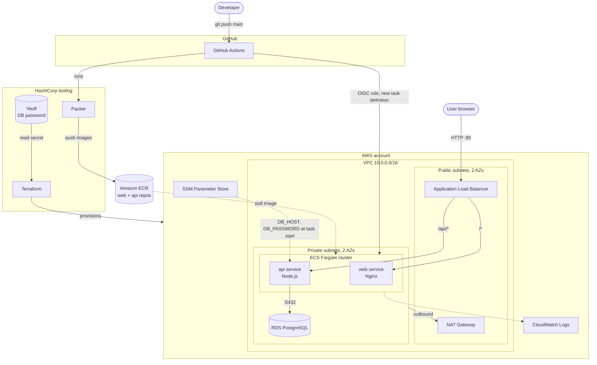

# ECS Notes: a production-style three-tier app on AWS ECS Fargate

A small notes app deployed the way real teams ship containers on AWS: an Nginx web tier and a Node.js API tier on **ECS Fargate**, a **PostgreSQL** database on **RDS**, images in **ECR**, traffic through an **Application Load Balancer**, configuration in **SSM Parameter Store**, everything inside a **VPC** with public and private subnets, and a **GitHub Actions** pipeline that builds and deploys on every push to `main`.

On top of the reference project I added the HashiCorp toolchain:

| Tool | What it does here |
|------|-------------------|
| **Terraform** | Provisions all of the AWS infrastructure (`terraform/`) |
| **Vault** | Holds the database password. Terraform reads it from Vault, so no secret is ever written in code or in GitHub (`vault/`) |
| **Packer** | Bakes the web and API container images and pushes them to ECR (`packer/`) |

## Credits

This project is my own build, based on the walkthrough **"Production-Style ECS Deployment"** by **[CREATOR NAME]**: https://youtu.be/j9jKK9kVprk

I watched it as a reference and rebuilt it with Terraform, Vault and Packer instead of following it click by click.

## Architecture



### How a request flows

1. The browser hits the ALB in the public subnets.
2. The ALB sends `/api/*` to the **api** service and everything else to the **web** service. Both run as Fargate tasks in private subnets with no public IPs.
3. The API talks to RDS PostgreSQL, which only accepts connections from the ECS security group.
4. When an API task starts, ECS pulls `DB_HOST`, `DB_NAME`, `DB_USER` and `DB_PASSWORD` from Parameter Store and injects them as environment variables.

### How secrets flow

`Vault (secret/ecs-notes/db)` &rarr; `Terraform` &rarr; `RDS master password` + `SSM SecureString` &rarr; `ECS task at runtime`

Vault is the single source of truth. Nothing sensitive lives in the repo or in GitHub.

### How a deploy flows

1. Push to `main`.
2. GitHub Actions validates the Terraform and Packer code.
3. It assumes an AWS role through **OIDC** (no long-lived AWS keys in GitHub).
4. **Packer** bakes both images, tags them with the commit SHA, and pushes them to ECR.
5. The pipeline registers new task definitions and rolls out both ECS services, waiting until they are healthy. The ECS deployment circuit breaker rolls back automatically if the new version fails.

## Repository layout

```
app/
  backend/      Node.js + Express API (the logic tier)
  frontend/     Static HTML/JS served by Nginx (the presentation tier)
terraform/      VPC, subnets, NAT, ALB, ECR, ECS, RDS, SSM, IAM, GitHub OIDC
packer/         Image builds for web and api
vault/          Vault policy and a setup script that seeds the DB password
.github/workflows/deploy.yml   CI/CD pipeline
docker-compose.yml             Run the full stack locally
```

## Run it locally

```bash
docker compose up --build
# open http://localhost:8080
```

## Deploy it to AWS

> This creates billable resources (NAT Gateway, RDS, ALB, Fargate). Run `terraform destroy` when you are done.

**Prerequisites:** AWS CLI configured with your own account, Terraform >= 1.5, Vault CLI, and this repo pushed to GitHub.

### 1. Put the database password in Vault

```bash
# terminal 1
vault server -dev -dev-root-token-id=root

# terminal 2
export VAULT_ADDR=http://127.0.0.1:8200
export VAULT_TOKEN=root
./vault/setup.sh
export VAULT_TOKEN=<scoped token printed by the script>
```

### 2. Provision the infrastructure with Terraform

```bash
cd terraform
cp terraform.tfvars.example terraform.tfvars   # set github_repo = "your-user/your-repo"
terraform init
terraform plan
terraform apply
```

The ECS services are created before any image exists in ECR, so their first tasks fail. That is expected, and the first pipeline run fixes it.

### 3. Connect GitHub Actions

Copy the `github_deploy_role_arn` output and add it in GitHub under **Settings > Secrets and variables > Actions > Variables** as `AWS_ROLE_ARN`. It is an ARN, not a secret, so a variable is fine. Until this variable exists the pipeline only runs the validation job.

### 4. Deploy

Push to `main` (or run the workflow manually from the Actions tab). When it finishes:

```bash
terraform output app_url
```

Open that URL and add a note. The status line at the top shows that the API can reach the database.

### 5. Tear down

```bash
terraform destroy
```

## Design choices

- **Fargate** instead of EC2 launch type, so there are no servers to patch.
- **Private subnets for the app and the database.** Only the ALB is public.
- **One NAT Gateway** to keep costs low. Production would run one per AZ.
- **Least-privilege IAM.** The task role has no permissions, the execution role can only read this project's parameters, and the GitHub role can only push to these two ECR repos and update ECS.
- **Terraform ignores `task_definition` on the services**, because the pipeline owns image rollouts and Terraform owns infrastructure.

## What I would add next

- HTTPS with an ACM certificate and a Route 53 domain
- Remote Terraform state in S3 with DynamoDB locking
- ECS service auto scaling on CPU
- Vault on HCP or a real cluster, with the AWS secrets engine for dynamic credentials
- A note about state: the DB password that Terraform reads from Vault is stored in Terraform state, which is another reason to keep state in an encrypted, access-controlled S3 bucket
